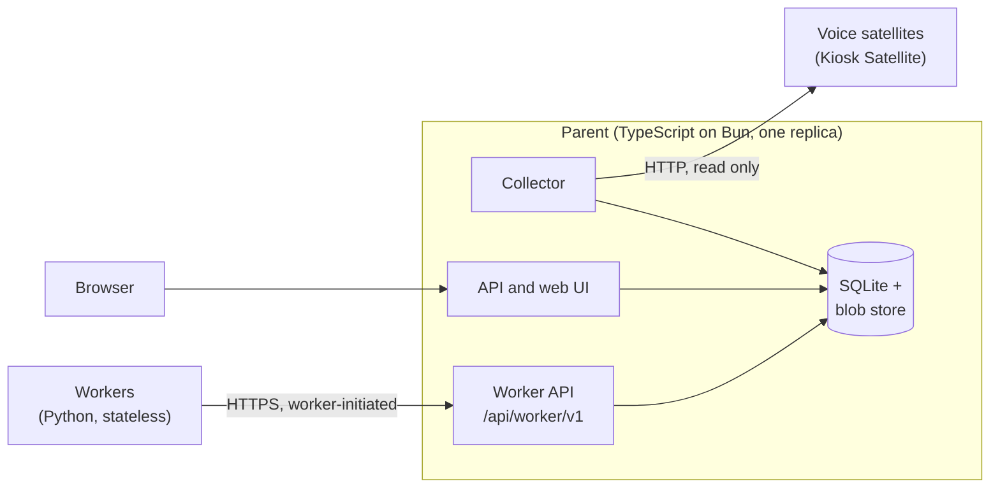
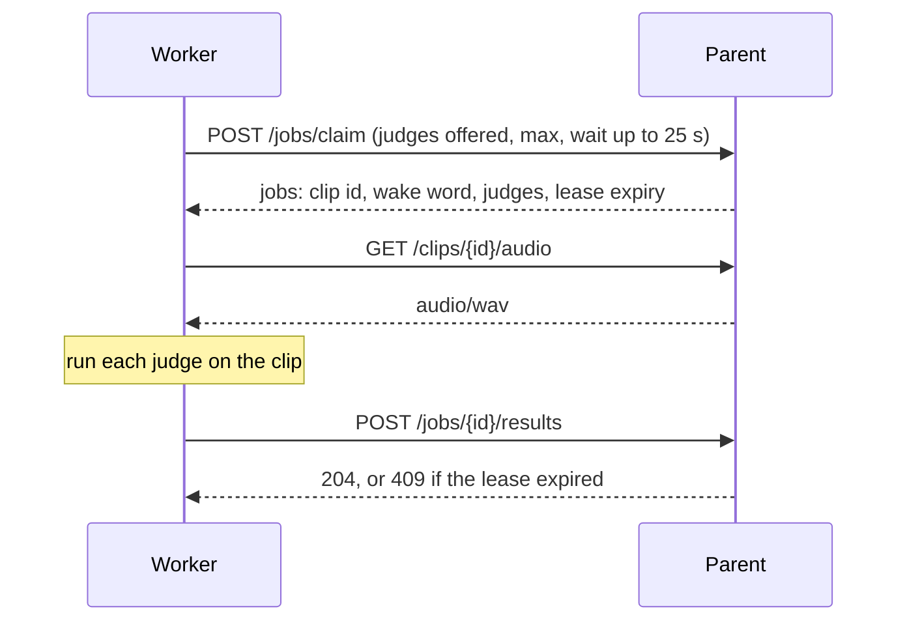

# Architecture

Wakewright has two kinds of process, a **parent** and **workers**
([ADR 0002](../adr/0002-parent-and-workers.md)). This page explains how
they fit together and how that grows over the [roadmap](README.md#roadmap).
The parent as built today, with its modules and repository layout, is in
[docs/architecture.md](../architecture.md).

## The parent

The parent is always on and owns all state: clips and their metadata
today; judge results, labels, datasets and the model registry later. It
collects clips from devices, serves the web UI and the API, and holds the
only copy of anything that matters. It runs as one replica because SQLite
has one writer ([ADR 0005](../adr/0005-sqlite-and-migrations.md)).

It contains no machine-learning libraries, and CI checks the image has no
Python. It does simple arithmetic over stored results (for example,
counting which judges agree), but anything that reads audio with a model,
fits a model or computes a statistic runs on a worker. This keeps the
parent small enough to run on a low-power home server and keeps every
piece of maths in one language.

Collection needs no worker. With no worker connected, clips are still
collected, stored and playable; judging simply waits.

## Workers

A worker is a stateless Python process that asks the parent for work,
does it, and sends back the result. It can run next to the parent, on a
laptop with `uv run`, or on a desktop with a GPU behind NAT. Because the
worker always starts the connection, it needs no inbound port, and the
parent needs no address for it.

The worker is a headless core with no Docker-only assumptions:
configuration comes from environment variables and its model cache
directory is configurable. That lets the same core be wrapped later in a
Windows desktop app, so a gaming PC can lend its GPU to training without
the user running containers.

Third-party models are never baked into the image or the repository. The
worker downloads each model on first use from its upstream source, pinned
by revision and checksum, into its cache. Some of these models carry
non-commercial licences (see [machine learning](machine-learning.md#models-and-licences)),
which is why they stay out of the Apache-2.0 artefacts.

## The pull protocol

The first version of the worker API serves one kind of work: judging
clips. The parent's committed OpenAPI document is the source of truth for
the wire format; what follows is the shape of it.

There is no stored job queue. A clip needs judging while it has no result
from a judge, at the version some connected worker offers. A short lease
stops two workers judging the same clip at once.

- **Claim** is a long poll: the parent holds the request until it has
  work or the wait runs out, then answers with an empty list. This works
  through ordinary reverse proxies and NAT with no WebSocket or extra
  dependency. The claim says which judges the worker runs, at which
  versions and for which wake words, and the parent records the worker's
  name, version and last-seen time from it.
- **Lease**: a claimed clip is reserved for about two minutes. A result
  sent after the lease expired, or by another claimant, is refused with
  `409`, so a slow or restarted worker cannot overwrite newer work.
- **Results** carry each judge's verdict (`yes`, `no` or `abstain`), score
  and threshold where it has them, a transcript for speech-to-text, a
  detail string and the time taken. A judge that fails on a clip reports
  `abstain` with the reason, so the clip is not retried forever.
- **Order**: new clips and the backlog are both judged, newest first.
- **Versions**: the claim carries a protocol version, and the parent
  answers `426` with the range it supports when they do not match. Each
  judge reports its own version string, which changes whenever its model
  or logic does, so results can be re-run when a judge improves.
- **Auth**: each worker has its own bearer token (only its hash is
  stored), created on the Workers page, which shows it once with a pairing
  string, or declared in the parent's configuration. Pausing, deleting or a
  new token takes effect at once. The worker API is separate from user
  sign-in ([ADR 0018](../adr/0018-workers-with-their-own-tokens.md)).

### How it grows

Training and evaluation are long jobs with files going both ways, so the
protocol will need more than judging does. The planned additions are
additive: stored jobs of several kinds, heartbeats that extend a lease
while a long job runs, separate lanes so judging never waits behind
training, and resumable uploads of trained models. Each will come with its own ADR
when it is built.

## Storage

Clips are kept until the user deletes them. Audio lives in a
content-addressed blob store next to the database, so a clip used in
several datasets is stored once. Later, a dataset snapshot will be a
single manifest that lists clips by hash rather than copying audio, and
deleting a clip will mark every snapshot that contained it, so a result
built on deleted data says so.

## Plugins

Devices are reached through a `Source` interface
([ADR 0011](../adr/0011-collecting-clips.md)); Kiosk Satellite is the first
implementation and will become a separate package when a second source
arrives. Judges, trainers and evaluators are planned as Python entry
points loaded by the worker, so third parties can add one without
forking. Any plugin kind that writes to a device is out of scope for now.
